# 🍏 Awesome Apple Silicon Vision-Language Inference 👁️⚡

### *Curated List of SaaS / Hosted Platforms & Open-Source Engines for Vision-Language Models (VLMs) on Apple Silicon*

  
  
  
  
  
  
  

  <b>Comprehensive directory for MLX multimodal pipelines, Metal Performance Shaders (MPS), quantized GGUF vision projectors, local VLM API servers, and distributed Apple Silicon clusters (M1 / M2 / M3 / M4).</b>

---

## 📖 Table of Contents

- [🌟 Introduction & Highlights](#-introduction--highlights)
- [📊 Sector Overview & Market Dynamics](#-sector-overview--market-dynamics)
- [☁️ SaaS & Hosted Platforms](#️-saas--hosted-platforms)
- [💻 Open-Source GitHub Projects](#-open-source-github-projects)
- [📈 Star History](#-star-history)
- [🤝 How to Contribute](#-how-to-contribute)
- [💖 Support](#-support)
- [⚖️ Disclaimer](#️-disclaimer)

---

## 🌟 Introduction & Highlights

This repository tracks the leading **SaaS/hosted platforms** and **open-source inference engines** for running multimodal **Vision-Language Models (VLMs)** natively on **Apple Silicon (M1, M2, M3, and M4)** Macs. 

Thanks to Apple Silicon's unified memory architecture (UMA), unified memory bandwidth (up to 800+ GB/s on Max/Ultra chips), and low-level frameworks like **Apple MLX** and **Metal Performance Shaders (MPS)**, Macs can load and run massive multimodal vision architectures—such as **Qwen2.5-VL**, **Llama 3.2 Vision**, **Pixtral**, **LLaVA-NeXT**, **PaliGemma 2**, **Janus-Pro**, and **Gemma 3**—entirely locally with zero cloud subscription fees and strict data privacy.

### 🔑 Key Capabilities Covered:
- 🖼️ **Multimodal VLM Inference**: Zero-shot image captioning, visual question answering (VQA), high-res OCR, document parsing, and video frame analysis.
- ⚡ **Native MLX Acceleration**: 4-bit, 6-bit, and 8-bit quantized weights via `mlx-community` and `mlx-vlm`.
- 🦙 **GGUF Multimodal Projection**: Running vision-language models via `llama.cpp` and `mmproj` clips.
- 🌐 **Distributed Mac Inference**: Aggregating Mac unified memory across Thunderbolt / Wi-Fi links using Exo.
- 🔌 **OpenAI-Compatible Local Endpoints**: Drop-in local inference servers for developer tools, IDE extensions, and internal agents.

---

## 📊 Sector Overview & Market Dynamics

The global market for AI inference and multimodal vision-language solutions is estimated at **$18 billion to $25 billion** and is projected to expand past **$90 billion by 2030** with an exponential CAGR exceeding 30%. Within this space, the Apple Silicon and edge-AI inference niche is experiencing massive acceleration driven by enterprise privacy demands, rising cloud GPU costs, and unified memory capacities reaching up to 128 GB–192 GB on workstation Macs.

The sector demonstrates **moderate fragmentation transitioning toward distinct dual-layer concentration**:
- **Cloud Infrastructure & Model Hub Layer**: Moderately concentrated, dominated by major hyperscalers (such as AWS and specialized hosts like MacStadium and Scaleway) and central open-weights hubs like Hugging Face.
- **Local Runtime & Edge Inference Layer**: Highly active and fragmented across community-driven runtimes (`llama.cpp`, `Ollama`, Apple `MLX`, and `Exo`). Rather than a single winner-take-all monopoly, standard open protocols (GGUF formats, MLX array libraries, and OpenAI-compatible HTTP APIs) allow modular coexistence between desktop applications, CLI developer tools, and distributed clusters.

---

## ☁️ SaaS & Hosted Platforms

Below is a curated comparison of hosted cloud platforms, dedicated Mac bare-metal servers, and model infrastructure providers for Apple Silicon vision-language pipelines, sorted by company size/valuation (descending):

| 🏢 Company / Platform | 🏷️ Size (Valuation / Revenue) | 💵 Starting Pricing Tier | 🎁 Free Tier / Trial Limits | 📝 Description |
| :--- | :--- | :--- | :--- | :--- |
| **[AWS EC2 Mac Instances](https://amazon.com)** | ~$2.2T Market Cap (AWS: ~$184B annualized run-rate) | $0.650/hour (`mac2.metal` M1, 24-hr minimum allocation = $15.60) | Free tier includes 750 hrs/month of `t2.micro`/`t3.micro` for 12 months + $100–$200 sign-up credits valid for 6 months (Note: physical EC2 Mac Dedicated Hosts are excluded from free credits) | On-demand Apple Silicon cloud servers enabling CI/CD benchmarking, automated testing, and cloud deployment of macOS VLM pipelines. |
| **[Scaleway Apple Silicon Cloud](https://scaleway.com)** | Parent Iliad Group: >€10B revenue (Scaleway: ~€100M–€200M revenue) | €0.17/hour or €115/month (Mac mini M2, 24-hour minimum allocation period) | Free-forever tier offers 1,000,000 Serverless Functions requests/month, 400,000 GB-s compute/month, and 1,000,000 free tokens for Generative AI APIs; new business accounts receive €100 trial credits | Dedicated cloud-hosted Apple Silicon Mac minis for running persistent MLX, Ollama, and Core ML vision-language APIs. |
| **[Hugging Face Inference Endpoints & Spaces](https://huggingface.co)** | $4.5B Valuation (~$150M ARR) | $0.03/hour (CPU Basic) / $9/month (Pro Tier) / $0.50/hour (T4 GPU Endpoint) | Free-forever tier includes unlimited public repositories, free CPU Basic Spaces (2 vCPU, 16 GB RAM), and free community ZeroGPU quota allocations | Managed cloud hosting and model hub distribution platform powering the `mlx-community` pre-quantized 4-bit and 8-bit Vision-Language Model ecosystem. |
| **[MacStadium (Orka Cloud)](https://macstadium.com)** | ~$13M–$35M Revenue ($68M total funding raised) | $109/month (Mac mini M2.S, 8-Core / 8GB RAM / 256GB SSD) | Free-forever local Orka Desktop tool for managing Apple Silicon VMs; no free trial for cloud hardware (enterprise PoC available upon sales consultation) | Cloud-hosted Apple Silicon (M1/M2/M3/M4) bare-metal and virtualized Mac infrastructure for scaling remote MLX and Metal multimodal inference workloads. |
| **[LM Studio](https://lmstudio.ai)** | ~$1.8M Revenue ($19.3M venture funding raised) | $0/month (Free for personal and internal commercial use); $20/month (Bionic+ tier) | Free-forever tier with unlimited local inference, model downloads, chat UI, and local OpenAI-compatible API serving on user hardware; paid features include 14-day trial | Polished local desktop application for Apple Silicon Macs with native MLX and `llama.cpp` backends, one-click VLM downloads, image drag-and-drop chat, and a local OpenAI-compatible API server. |

---

## 💻 Open-Source GitHub Projects

All open-source runtimes, array frameworks, and distributed clusters supporting Vision-Language Models on Apple Silicon, ranked by GitHub Stars_Count (descending). Each repository features a real-time Stars_Badge linking to its GitHub stargazers page:

1. **[Ollama](https://github.com/ollama/ollama)**   
   The most widely adopted open-source local model runner for macOS. Features native Metal acceleration for running multimodal vision models (LLaVA, Llama 3.2 Vision, Qwen2.5-VL, Gemma 3) with an easy CLI and OpenAI-compatible REST server.

2. **[Transformers (Hugging Face)](https://github.com/huggingface/transformers)**   
   The central open-source machine learning library providing foundational Vision-Language Model support (Qwen2-VL, Pixtral, Idefics3, PaliGemma) with native PyTorch Metal Performance Shaders (`torch.device("mps")`) acceleration on macOS.

3. **[Open WebUI](https://github.com/open-webui/open-webui)**   
   Self-hosted, highly extensible web interface with drag-and-drop multimodal image chatting, document reasoning, and seamless integration with Ollama, `mlx-vlm`, or LM Studio backends.

4. **[llama.cpp](https://github.com/ggml-org/llama.cpp)**   
   Foundational open-source C/C++ inference engine with hand-crafted Apple Metal kernels and `libmtmd` / `mmproj` support for running quantized GGUF Vision-Language Models locally with minimal resource footprint.

5. **[vLLM](https://github.com/vllm-project/vllm)**   
   High-throughput LLM and VLM serving engine featuring experimental Apple Silicon CPU and Metal execution backends for continuous batching, PagedAttention, and production multimodal serving.

6. **[Whisper.cpp](https://github.com/ggerganov/whisper.cpp)**   
   High-performance C/C++ port of OpenAI's Whisper with dedicated Apple Metal optimization, frequently chained alongside vision-language models for complete audio-visual multimodal pipelines on Mac.

7. **[LlamaIndex](https://github.com/run-llama/llama_index)**   
   Leading data framework for connecting multimodal vision-language models to external images, PDF documents, and knowledge graphs on Apple Silicon via local Ollama and MLX connectors.

8. **[LocalAI](https://github.com/mudler/LocalAI)**   
   Open-source drop-in replacement for OpenAI APIs supporting Metal-accelerated GGUF and MLX backends for local vision analysis, audio transcription, and text generation on macOS.

9. **[Exo](https://github.com/exo-explore/exo)**   
   Peer-to-peer distributed AI cluster framework that pools unified memory across multiple Apple Silicon Macs over Thunderbolt or local Wi-Fi to run large multimodal VLMs across devices via MLX.

10. **[Jan.ai](https://github.com/janhq/jan)**   
    Open-source, privacy-first desktop AI assistant for macOS powered by `llama.cpp` and Cortex, supporting local multimodal image queries and OpenAI-compatible endpoints with zero telemetry.

11. **[SGLang](https://github.com/sgl-project/sglang)**   
    Fast structured-generation and VLM serving runtime supporting multi-turn multimodal prompting, RadixAttention KV-cache reuse, and experimental Apple Silicon execution.

12. **[Apple MLX](https://github.com/ml-explore/mlx)**   
    Apple Silicon's native array framework developed by Apple machine learning research, purpose-built for unified memory architectures with native Metal JIT compilation and multimodal computation.

13. **[LLaVA](https://github.com/haotian-liu/LLaVA)**   
    Pioneering open-source Large Language and Vision Assistant project that set the benchmark for multimodal visual instruction tuning, fully deployable via quantized weights on Apple Silicon.

14. **[Qwen2.5-VL](https://github.com/QwenLM/Qwen2.5-VL)**   
    State-of-the-art vision-language model repository supporting high-res image understanding, video analysis, and document parsing, with full MLX and GGUF quantization for Apple Macs.

15. **[Janus (Janus-Pro)](https://github.com/deepseek-ai/Janus)**   
    DeepSeek's advanced multimodal understanding and visual generation architecture, featuring unified autoregressive modeling for vision-language inference and image synthesis on Apple Silicon.

16. **[Apple MLX Examples](https://github.com/ml-explore/mlx-examples)**   
    Official repository of reference implementations demonstrating how to run multimodal vision models, text generation, and audio processing natively using MLX.

17. **[mlx-vlm](https://github.com/Blaizzy/mlx-vlm)**   
    Premier specialized toolkit for running, quantizing, and serving Vision-Language Models (Qwen2-VL, Pixtral, PaliGemma, Gemma 3, InternVL) on Apple Silicon with native MLX performance and an OpenAI-compatible server.

18. **[Core ML Tools](https://github.com/apple/coremltools)**   
    Apple's official toolkit for converting, optimizing, and quantizing PyTorch vision encoders and transformer layers to run on the Apple Neural Engine (ANE) and GPU.

19. **[ExecuTorch](https://github.com/pytorch/executorch)**   
    PyTorch's end-to-end framework for edge AI deployments, featuring an MPS backend for running multimodal models on macOS and iOS devices.

20. **[MLX Swift Examples](https://github.com/ml-explore/mlx-swift-examples)**   
    Collection of ready-to-run native Swift and SwiftUI applications demonstrating on-device MLX multimodal and vision inference for macOS and iOS developers.

21. **[MLX Swift](https://github.com/ml-explore/mlx-swift)**   
    Native Swift language bindings for Apple MLX, allowing developers to embed vision-language inference and neural models directly into native Apple apps.

22. **[Aphrodite Engine](https://github.com/PygmalionAI/aphrodite-engine)**   
    Open-source large-scale serving engine engineered for high-concurrency model execution and quantized multimodal architectures across heterogeneous compute hardware.

23. **[OpenedAI Vision](https://github.com/matatonic/openedai-vision)**   
    Lightweight, self-hosted OpenAI-compatible Vision API server wrapper supporting local multimodal vision pipelines on macOS with simple setup.

---

## 📈 Star History

---

## 🤝 How to Contribute

Contributions are always welcome! Help keep this ecosystem guide up-to-date for the Apple Silicon AI developer community.

1. 🍴 **Fork the repository** on GitHub.
2. 🌿 **Create a new branch** (`git checkout -b feature/add-new-vlm-project`).
3. 📝 **Add your project** under the appropriate section (following the existing table or list format).
4. ⭐ **Include repository link, description, and Stars_Badge**.
5. 🚀 **Submit a Pull Request** with a concise description of the addition.

---

## 💖 Support

Thank you for visiting and supporting the **Awesome Apple Silicon Vision-Language Inference** ecosystem! 🚀

If this repository helps your research, workflow, or applications, please consider supporting the project:
- ⭐ **Star this repository** to help others discover it.
- 🍴 **Fork and share** it with your developer community and colleagues.
- ☕ **Buy a Coffee / Sponsor**: Support continued open-source curation via the [GitHub Sponsor Dashboard](https://github.com/sponsors/ishandutta2007).

---

## ⚖️ Disclaimer

- This is an independent, **community-curated** list for educational and research purposes. It is not affiliated with or endorsed by Apple Inc.
- Apple, Mac, Apple Silicon, M1, M2, M3, M4, macOS, Metal, and Core ML are trademarks of Apple Inc.
- Running multimodal Vision-Language Models requires sufficient unified memory: 16 GB is recommended as a baseline, while 32 GB–128 GB+ is suggested for unquantized or multi-image high-resolution models.
- Always check and verify open-weight model licenses (e.g., Apache 2.0, MIT, Llama Community License, Qwen License) prior to commercial deployment.

---

  <b>Built with ❤️ for Apple Silicon developers, multimodal AI researchers, and the open-source community.</b>

